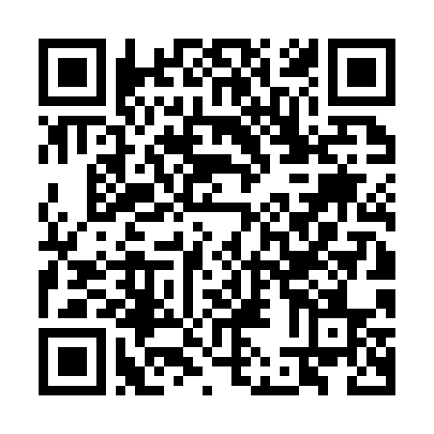

# Respira — Android download

Mobile spirometry for the Contec SB80B.

Scan with an Android phone, or open
**https://github.com/Reserted/Respira-releases/releases/latest/download/respira.apk**

The link always serves the newest release, so this QR code never changes.

## Installing

1. Scan the code and download `respira.apk`.
2. Open it. Android will ask to allow installs from your browser or file
   manager — allow it for that app only.
3. Install, then open **Respira**.

USB-OTG needs an OTG cable to the spirometer; plugging it in offers to open the
app and grant USB permission. Bluetooth needs the location/nearby-devices
permission the app asks for on first scan.

## Not a medical device

Results are for personal tracking only and must not be used for diagnosis.
